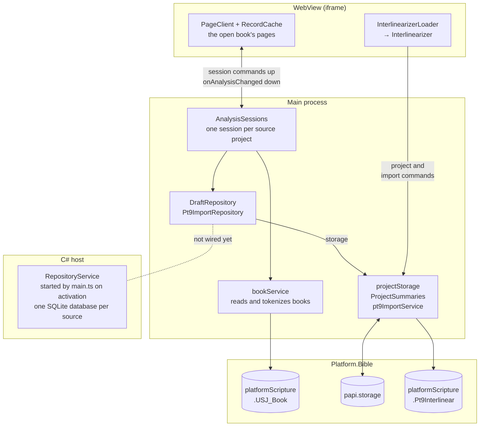
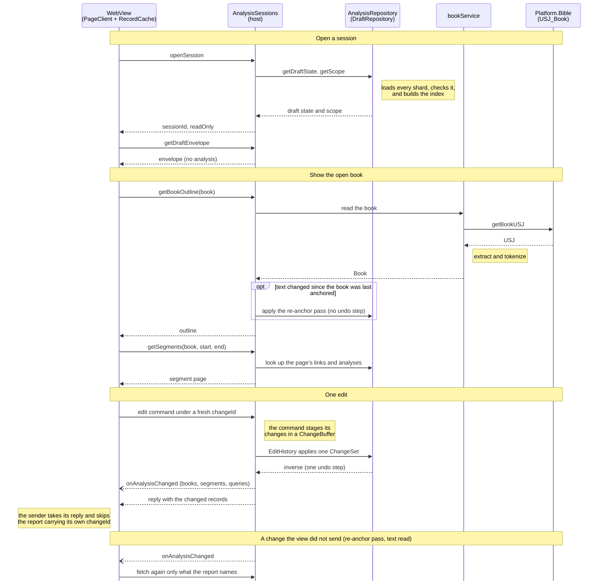
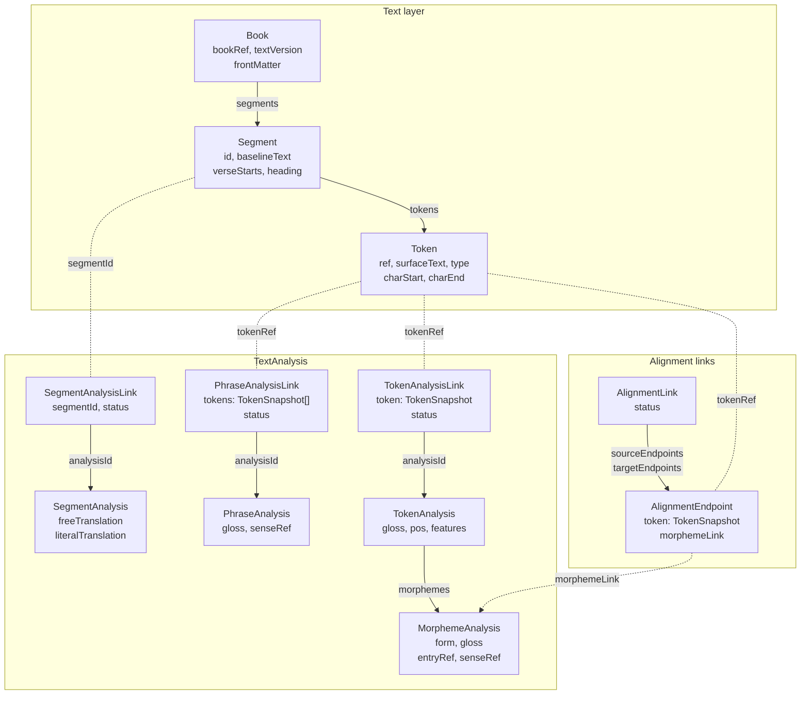
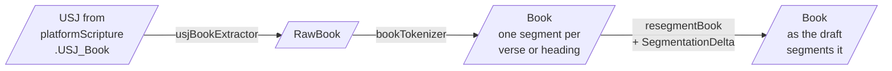
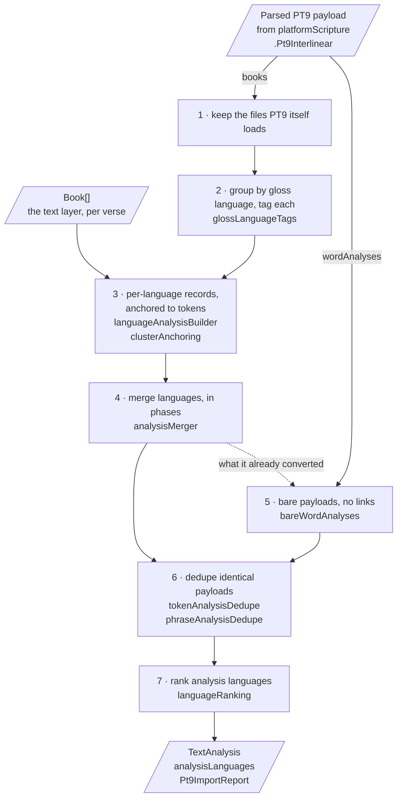
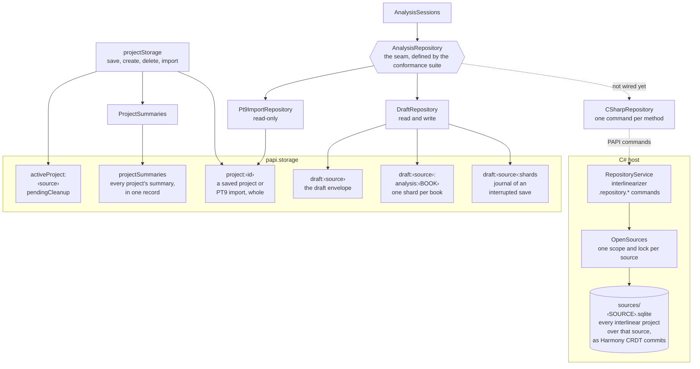
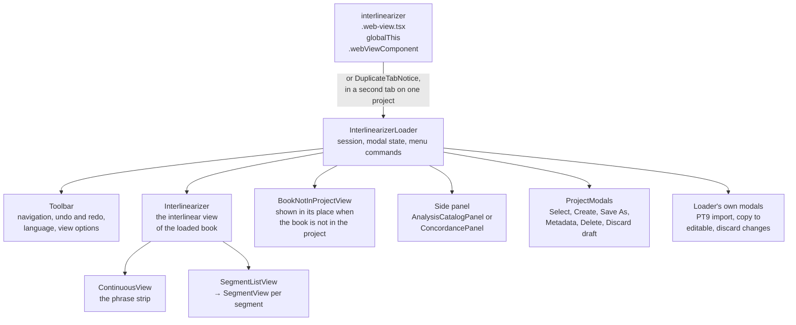
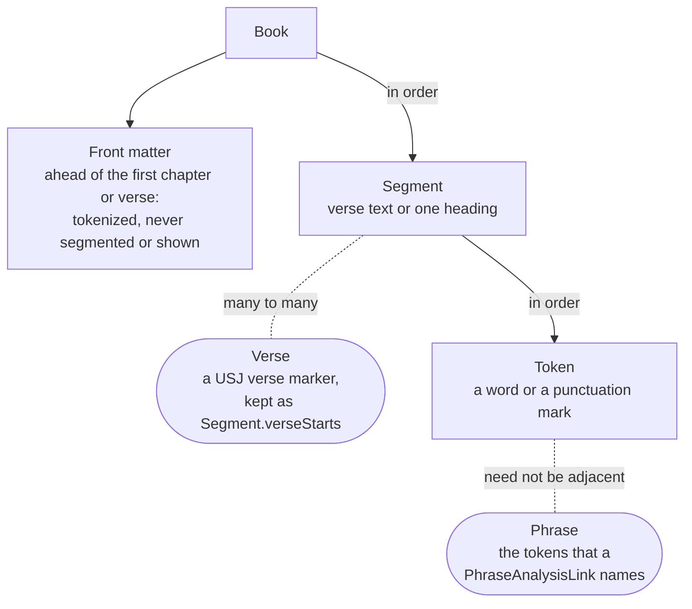

# Architecture diagrams

Seven diagrams of the Interlinearizer's design: its processes, a session's data flow, the data model, the text pipelines, storage, the WebView's component tree, and the text's units.

They draw what [AGENTS.md](../AGENTS.md#architecture) treats as design: processes, seams, contracts, and record types. They leave out module internals, hooks, command modules, timing, and focus, which change too often for a drawing to keep up with. AGENTS.md says why each part is shaped the way it is.

Each diagram names the commit it was checked against and the files it was drawn from. When one of those files changes shape, check its diagram again and update the commit.

1. [Processes and channels](#1-processes-and-channels)
2. [A session's data flow](#2-a-sessions-data-flow)
3. [Data model](#3-data-model)
4. [Text pipelines](#4-text-pipelines)
5. [Storage](#5-storage)
6. [WebView component tree](#6-webview-component-tree)
7. [The text's units](#7-the-texts-units)

## 1. Processes and channels

Three processes of ours run beside Platform.Bible: the WebView, the extension's main process, and the C# host. Everything between them crosses the PAPI network as JSON.

- The WebView never reads scripture or storage itself. It sends commands to the main process and listens for `interlinearizer.onAnalysisChanged`.
- The draft stays in the main process. The WebView holds only the draft's envelope and the pages its views show.
- `main.ts` starts the C# host on activation and stops it on deactivation. The host registers its `interlinearizer.repository.*` commands on the PAPI network over its own WebSocket client. No session stores analysis through it yet: only the conformance suite calls it.
- `pt9ImportService` reads the Paratext 9 payload and each imported book's USJ, and saves the import through `projectStorage`.
- `projectStorage` owns every `papi.storage` read and write, the repositories' included.

Checked against main @ `f614485`. Sources: [src/main.ts](../src/main.ts), [src/services/analysisSessions.ts](../src/services/analysisSessions.ts), [src/services/bookService.ts](../src/services/bookService.ts), [src/services/projectStorage.ts](../src/services/projectStorage.ts), [src/services/pt9ImportService.ts](../src/services/pt9ImportService.ts), [src/services/csharpHost.ts](../src/services/csharpHost.ts), [src/hooks/useSessionPages.ts](../src/hooks/useSessionPages.ts), [src/cache/pageClient.ts](../src/cache/pageClient.ts), [c-sharp/InterlinearizerHost/Services/RepositoryService.cs](../c-sharp/InterlinearizerHost/Services/RepositoryService.cs).

## 2. A session's data flow

One session, from opening it to one edit. "Host" here is the extension's main process, not the C# host.

- Opening a session reads none of the source's text. The whole text is read only once a feature needs it.
- A session runs its commands one at a time. An edit sent again under a `changeId` the session still keeps a reply for gets that reply back and is not applied twice.
- The session emits the change report while it builds the reply, so the two can reach the WebView in either order. `PageClient` handles both.
- Undo and redo follow the edit's path: `EditHistory` applies the inverse, and the session re-anchors what it restores.
- [reanchoring.md](reanchoring.md) says when a re-anchor pass runs and how far it goes.

Checked against main @ `f614485`. Sources: [src/services/analysisSessions.ts](../src/services/analysisSessions.ts), [src/services/sessionPageHandlers.ts](../src/services/sessionPageHandlers.ts), [src/services/editHistory.ts](../src/services/editHistory.ts), [src/services/commands/changeBuffer.ts](../src/services/commands/changeBuffer.ts), [src/services/analysisChanges.ts](../src/services/analysisChanges.ts), [src/cache/pageClient.ts](../src/cache/pageClient.ts), [src/hooks/useSessionChange.ts](../src/hooks/useSessionChange.ts), [src/main.ts](../src/main.ts).

## 3. Data model

The text layer is a hierarchy that is rebuilt from USJ on each load and never stored. The analysis layer is flat, stored, and joined to the text only by the ref and id strings its links carry.

- Solid arrows are containment or ids within what is stored. Dotted lines join a stored record to the text on a string derived from that text (`Segment.id`, `Token.ref`), which is why a text edit needs a re-anchor pass.
- An `InterlinearProject` is the envelope around both stored parts: `analysis` is the `TextAnalysis` and `links` holds the `AlignmentLink`s. It also carries the source and target project ids, `analysisLanguages`, `modelVersion`, and the `segmentation` that merges and splits verses into segments.
- A payload (`TokenAnalysis`, `PhraseAnalysis`, `SegmentAnalysis`) is shared by every occurrence analyzed the same way. Each occurrence has its own link, and the link carries the `status`.
- A `TokenSnapshot` holds the token's ref and its surface text, so a link can tell when the text under it has drifted.
- At most one link per token or segment is `approved`.
- A draft (`DraftProject`) is the same envelope without the project's name and id, plus a `dirty` mark.

Checked against main @ `f614485`. Source: [src/types/interlinearizer.d.ts](../src/types/interlinearizer.d.ts).

## 4. Text pipelines

Two pipelines produce the two layers. The first builds the text layer from Platform.Bible's USJ, on every book read. The second, `convertPt9Project`, converts a Paratext 9 interlinear payload (`Pt9InterlinearProjectData`) into analysis, and needs the first's output to anchor on.

- `resegmentBook` applies the draft's merged and split boundaries. The import anchors on the plain per-verse book.
- Stages 3 and 5 both look glosses up in one index built from the payload's lexicon (`pt9GlossSource`).
- Stage 4 runs as one function per phase: merge token records, fuse parse-only records, emit token analyses, then merge and emit phrases.
- Stage 7 orders `analysisLanguages` by how many tokens each language's glosses show.
- Every stage counts what it drops on the one `Pt9ImportReport`.
- The platform reads and parses the PT9 XML. [pt9-xml.md](../src/parsers/pt9/pt9-xml.md) documents that XML.

Checked against main @ `f614485`. Sources: [src/parsers/papi/usjBookExtractor.ts](../src/parsers/papi/usjBookExtractor.ts), [src/parsers/papi/bookTokenizer.ts](../src/parsers/papi/bookTokenizer.ts), [src/parsers/papi/resegmentBook.ts](../src/parsers/papi/resegmentBook.ts), [src/services/bookService.ts](../src/services/bookService.ts), [src/services/pt9ImportService.ts](../src/services/pt9ImportService.ts), [src/converters/pt9/convertPt9Project.ts](../src/converters/pt9/convertPt9Project.ts), [src/converters/pt9/analysisMerger.ts](../src/converters/pt9/analysisMerger.ts), [src/converters/pt9/languageRanking.ts](../src/converters/pt9/languageRanking.ts).

## 5. Storage

`AnalysisRepository` is the seam that a storage backend implements. Two implementations store in `papi.storage` and serve sessions today. The third reaches the C# host and is not wired to sessions yet.

- A draft is per source project. Its analysis is split into per-book shards, so a save rewrites only the books that changed.
- A saved project and a Paratext 9 import are each one whole record under `project:‹id›`. An import carries a `pt9Import` field.
- Listing projects reads only `projectSummaries`, and no analysis.
- Save copies the draft into a project record and rebuilds the rest of that record from its summary.
- On the C# side, each `ChangeSet` is one commit, so it lands whole or not at all.

Checked against main @ `f614485`. Sources: [src/types/analysis-repository.ts](../src/types/analysis-repository.ts), [src/services/storageKeys.ts](../src/services/storageKeys.ts), [src/services/draftRepository.ts](../src/services/draftRepository.ts), [src/services/pt9ImportRepository.ts](../src/services/pt9ImportRepository.ts), [src/services/csharpRepository.ts](../src/services/csharpRepository.ts), [src/services/projectStorage.ts](../src/services/projectStorage.ts), [src/services/projectSummaries.ts](../src/services/projectSummaries.ts), [c-sharp/InterlinearizerCrdt/OpenSources.cs](../c-sharp/InterlinearizerCrdt/OpenSources.cs), [c-sharp/InterlinearizerHost/Services/RepositoryService.cs](../c-sharp/InterlinearizerHost/Services/RepositoryService.cs).

## 6. WebView component tree

The top three levels only. Contexts and stores are left out.

- The book area and the side panel sit inside `SessionAnalysisProvider`, which hands them the session's `PageClient`.
- `InterlinearizerLoader` is the real top of the tree. The root component only picks between it and the duplicate-tab notice.
- `ProjectModals` mounts one project dialog at a time, switching on its `ModalState`.
- `Interlinearizer` always shows `SegmentListView`, and adds `ContinuousView` above it when continuous scroll is on.
- Every modal goes through `ModalShell`.

Checked against main @ `f614485`. Sources: [src/interlinearizer.web-view.tsx](../src/interlinearizer.web-view.tsx), [src/components/InterlinearizerLoader.tsx](../src/components/InterlinearizerLoader.tsx), [src/components/Interlinearizer.tsx](../src/components/Interlinearizer.tsx), [src/components/modals/ProjectModals.tsx](../src/components/modals/ProjectModals.tsx).

## 7. The text's units

The units, and the places where one does not nest inside another. Code that derives one unit from another by interval or by position goes wrong in exactly these places.

Books, segments, and tokens nest cleanly: each token is in one segment, and each segment in one book. A heading is a segment too. Verses and phrases lie across that hierarchy.

| Where nesting fails             | What happens                                                                                                                                                                                   | What to rely on                                                                                                                                      |
| ------------------------------- | ---------------------------------------------------------------------------------------------------------------------------------------------------------------------------------------------- | ---------------------------------------------------------------------------------------------------------------------------------------------------- |
| One segment, several verses     | A merge joins verses into one segment, across a chapter boundary too.                                                                                                                          | `Segment.verseStarts` lists each verse the segment holds. Test containment with `segmentContainsVerse`, never with the `startRef`–`endRef` interval. |
| One verse, several segments     | A split, or a heading within a verse's text, leaves the verse in two or more segments. The later piece's verse start is flagged `isContinuation`, and its id is its first token's ref.         | Every piece contains the verse. A caller that needs one segment takes the first in document order.                                                   |
| One verse label, several verses | A USJ label such as `3-4` is kept verbatim and covers both verses. A label with no digits covers none.                                                                                         | `verseLabelCovers`.                                                                                                                                  |
| Headings                        | A heading is a segment of its own, filed under the verse before it, or under verse 0 ahead of a chapter's first verse. It never merges or splits with verse text.                              | `Segment.heading`.                                                                                                                                   |
| Phrases                         | A phrase's tokens need not be adjacent (`ne … pas`). The model permits a phrase across segments within one book. A boundary edit first splits each approved phrase the new boundary would cut. | The link's `tokens`, in order.                                                                                                                       |
| Punctuation                     | Punctuation tokens are in the text layer, so that the baseline text can be rebuilt, but they typically carry no analysis.                                                                      | `Token.type`.                                                                                                                                        |

A token's ref embeds its verse and its character offset in that verse (`GEN 1:1:7`), and a segment's id derives from its verse. So refs and ids change when the text or the boundaries do. [reanchoring.md](reanchoring.md) covers how stored analysis follows them.

Checked against main @ `f614485`. Sources: [src/types/interlinearizer.d.ts](../src/types/interlinearizer.d.ts), [src/utils/verse-ref.ts](../src/utils/verse-ref.ts), [src/parsers/papi/bookTokenizer.ts](../src/parsers/papi/bookTokenizer.ts), [src/parsers/papi/resegmentBook.ts](../src/parsers/papi/resegmentBook.ts), [src/services/commands/boundaryCommands.ts](../src/services/commands/boundaryCommands.ts).
