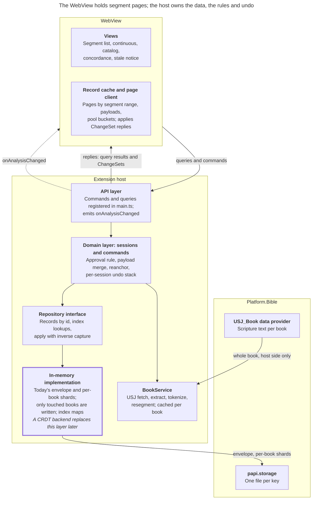
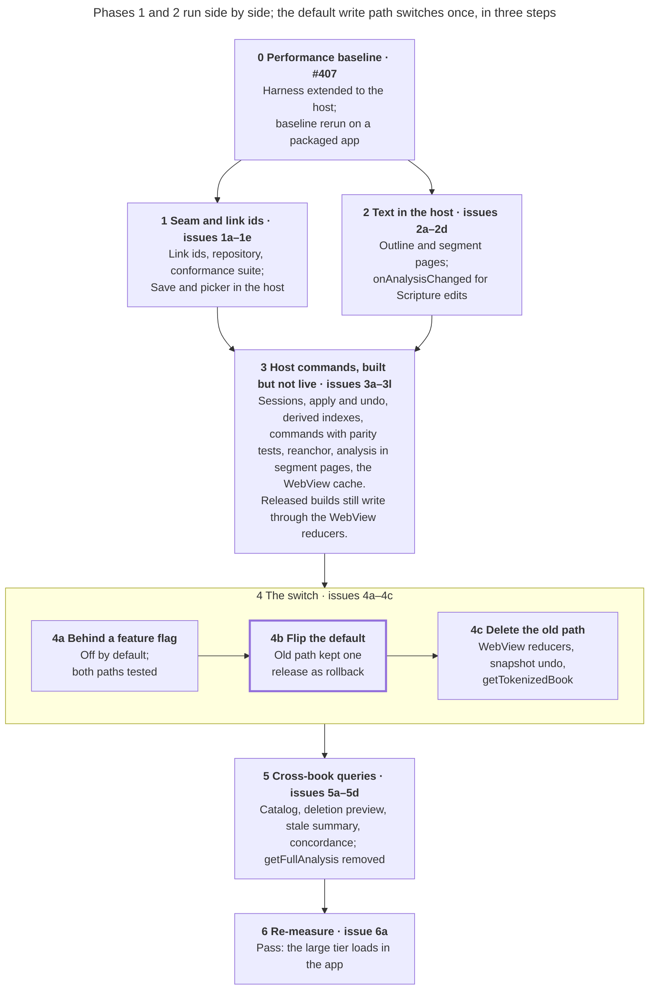

# Merged data layer plan (#403)

Oct 9, 2026

The extension host takes ownership of the analysis, the domain logic and undo, and serves the WebView segment pages: the text and analysis for a segment range. Storage stays in today's format behind one repository interface, which a CRDT backend can replace later. That interface and its conformance suite, the tests any backend must pass, are the seam. Every release along the way has exactly one default write path. Merged from the plans by Danny (D), Alex (A) and Jason (J), using the decisions the team made on 2026-10-09. "Today" means main at 36fa9f8 (2026-10-08).

## Decisions

The team decided these on 2026-10-09. "From" names the plan each choice came from. Rows marked _carried_ were not discussed directly; they follow from decisions above them and are open to correction.

| Question                                               | Decision                                                                                                                                                                                                                                                                                   | From    |
| ------------------------------------------------------ | ------------------------------------------------------------------------------------------------------------------------------------------------------------------------------------------------------------------------------------------------------------------------------------------ | ------- |
| Who owns the data                                      | The host owns the analysis, the domain logic and undo. The WebView is a cache of the segment pages on screen                                                                                                                                                                               | D, A, J |
| Domain logic                                           | Host commands written against the repository replace the reducers. No release has a broken intermediate state: exactly one write path is live at a time                                                                                                                                    | J       |
| Approval rule (one approved link per token or segment) | Enforced in the domain layer. Loads and PT9 import saves keep reporting breaches at the storage boundary; project Save stops in 4c                                                                                                                                                         | J       |
| Storage layout                                         | Today's format: the envelope (the project record) plus per-book shards (one stored analysis per book). Only books an edit touched since the last autosave are rewritten                                                                                                                    | J       |
| Existing data                                          | No model version bump and no migration. Existing data is disposable; a draft or saved interlinear project with any link that has no id loads as empty, with a log entry                                                                                                                    | —       |
| Storage-model changes for the CRDT direction           | Ids on every link; derived indexes (lookups by token ref, segment id, analysis id, normalized form, and book plus status) rebuilt from the records and never trusted; a conformance suite at the seam                                                                                      | D, A, J |
| CRDT                                                   | Not chosen. No spike in this plan, and the seam doesn't name a backend                                                                                                                                                                                                                     | D, A    |
| Draft vs. saved interlinear project                    | The split stays. Save and Save As copy inside the host. Draft-as-pending-changes is left to the CRDT design                                                                                                                                                                                | D, A, J |
| Paging unit                                            | Segment ranges, plus a book outline                                                                                                                                                                                                                                                        | D, J    |
| Change delivery                                        | Commands reply with the `ChangeSet`, a list of whole-record puts and deletes, to the caller. `onAnalysisChanged` names the touched segment ranges, analysis ids and cross-book queries so other views refetch; a Scripture edit or a future Send/Receive names a whole book or scope       | A       |
| Undo                                                   | Inverse `ChangeSet`s captured in the repository's `apply`; one linear stack per session; the reanchor pass is recorded as a step; a whole-scope change (New, Open or opening a session, but not a wipe) clears the history, and 3j sets how large a Scripture edit must be to clear it too | D, A, J |
| Transport                                              | PAPI commands plus one network event, not a data provider                                                                                                                                                                                                                                  | D, A, J |
| Optimistic updates                                     | None, unless the edit-latency check at 4b fails: the host path's dispatch-to-render p90 exceeds the #407 performance baseline's p90 at any tier                                                                                                                                            | D, A, J |
| Shared payloads                                        | One record, never copied per book                                                                                                                                                                                                                                                          | D, A, J |
| Addressing                                             | _Carried:_ each open draft gets a session, a host-side handle for the draft and its interlinear project, addressed by a `sessionId`                                                                                                                                                        | J       |
| Concurrent commands                                    | _Carried:_ no segment-page versions; the host runs one command at a time per session, and only one WebView opens per source project                                                                                                                                                        | —       |
| Suggestions                                            | _Carried:_ pool buckets, the approved payloads that share a normalized form, ride in segment pages and in replies; the WebView keeps `deriveTokenSuggestion`                                                                                                                               | J       |

## The seam

After Phase 5, only queries, commands, their replies and one network event cross PAPI. A CRDT backend later replaces the in-memory implementation; the domain layer, the API layer and the WebView stay put.

### API sketch

The names are working names, settled when each issue lands. Every call is a PAPI command. In this plan a _command_ changes state (an edit, undo, Save, or opening a session) and a _query_ only reads; the Kind column says which. A command by intent is one command, such as `writeGloss`; a command family is the set of commands one issue builds.

| Call                                                                              | Kind    | Request                                      | Response                                                                                                                                 | Replaces today                                          | Issue    |
| --------------------------------------------------------------------------------- | ------- | -------------------------------------------- | ---------------------------------------------------------------------------------------------------------------------------------------- | ------------------------------------------------------- | -------- |
| `openSession` / `closeSession`                                                    | command | source project, optional interlinear project | `sessionId`, read-only flag, `hasFreeTranslations`                                                                                       | `getDraft` seeding Redux                                | 3a       |
| `getBookOutline`                                                                  | query   | session, book                                | Segment ids, verse labels, each segment's `heading` (from `Segment`), token counts, stale flags                                          | `useBookIndexes`, `useSegmentHeights`, the chapter list | 2b, 5c   |
| `getSegments`                                                                     | query   | session, book, segment range                 | Tokenized segments; from 3k, their links, referenced payloads and pool buckets                                                           | `USJ_Book` fetch and tokenizing in the WebView          | 2b, 3k   |
| Commands by intent (`writeGloss`, `approveAnalysisForToken`, `createPhrase`, ...) | command | session, intent arguments                    | `ChangeSet`                                                                                                                              | Dispatch plus whole-draft `saveDraft`                   | 3d to 3i |
| `undo` / `redo`                                                                   | command | session                                      | `ChangeSet`                                                                                                                              | Whole-draft snapshots in `undo-history.ts`              | 3b       |
| `save` / `saveAs`                                                                 | command | draft (1d); session (from 4a), metadata      | Project metadata                                                                                                                         | `saveAnalysis` with the whole analysis                  | 1d       |
| `getCatalogRows`                                                                  | query   | session, filter, sort, offset, count         | Rows plus a total                                                                                                                        | `selectCatalogRows`                                     | 5a       |
| `previewDeletion`                                                                 | query   | session, analysis id                         | Deletion outcome                                                                                                                         | `selectAnalysisDeletionOutcome`                         | 5b       |
| `getStaleSummary`                                                                 | query   | session, book                                | Stale links and free translations                                                                                                        | The stale selectors                                     | 5c       |
| `getConcordance`                                                                  | query   | session, form, offset, count                 | Rows joined with their payloads                                                                                                          | `useConcordanceIndex` and the panel joins               | 5d       |
| `onAnalysisChanged`                                                               | event   | —                                            | Session, change id, touched segment ranges by book, analysis ids, affected cross-book queries; a whole book or scope for Scripture edits | Nothing today                                           | 2d, 3k   |
| `getTokenizedBook`, `getFullAnalysis`                                             | query   | session, book                                | Whole book, whole analysis                                                                                                               | Temporary bridges, removed in 4c and 5d                 | 2a, 4a   |

### Contract rules

These rules describe the target state after Phase 5.

- A `ChangeSet` is a list of whole-record puts and deletes, keyed by record type and id.
- The repository's `apply` is all-or-nothing, records each record's prior value for undo, and keeps the derived indexes current.
- Derived indexes are rebuilt from the records on load and never trusted over them.
- Index lookups are part of the repository interface, and the conformance suite tests them. The in-memory implementation backs them with maps; a later backend answers them its own way.
- The domain layer enforces the approval rule before it calls `apply`.
- No read returns a whole document, apart from the two temporary bridges.
- The conformance suite defines the seam. Any later backend passes it to replace the in-memory implementation.

## Phases at a glance

| #   | Phase                             | What the WebView sees               | Why each release is whole                                                                   | Needs |
| --- | --------------------------------- | ----------------------------------- | ------------------------------------------------------------------------------------------- | ----- |
| 0   | Performance baseline              | Nothing                             | Measurement only                                                                            | —     |
| 1   | Seam and link ids                 | Faster Save and picker              | The repository sits behind today's `getDraft`/`saveDraft`; the WebView still owns the edits | 0     |
| 2   | Text in the host                  | Text from outline and segment pages | Only text moves; analysis is untouched                                                      | 0     |
| 3   | Host commands, built but not live | Nothing                             | No released build calls the new write path                                                  | 1, 2  |
| 4   | The switch                        | Edits, undo and Save go to the host | A feature flag, then a flip with a rollback, then deletion                                  | 3     |
| 5   | Cross-book queries                | Panels call host queries            | One query per PR; `getFullAnalysis` covers the rest                                         | 4     |
| 6   | Re-measure                        | Nothing                             | Measurement only                                                                            | 5     |

Phases 1 and 2 don't depend on each other and can proceed in parallel. The switch is all of Phase 4. The flip (4b) is its middle step: the one release where the feature flag's default, and with it the default write path, changes.

## Phases

### Phase 0: Performance baseline

Phase 0 is [#407](https://github.com/sillsdev/interlinearizer-extension/issues/407), which defines the dataset tiers, the `ilz:` marks and the timing names used below. It covers the baseline harness (PR #411), extends it to the host because later phases move memory and time out of the WebView, and reruns the baseline on a packaged app, cold and warm, 10 runs, reported as median and p90. All of it is done before Phases 1 and 2 start.

- Host process heap through a debug PAPI command, and host-side `ilz:` marks.

**Done when:** a run reports host and WebView numbers side by side.

### Phase 1: Seam and link ids

Every read and write of interlinear data goes through the repository, and links get ids. The WebView doesn't change, apart from Save and the picker getting faster.

- **Link ids.** `TokenAnalysisLink` and `SegmentAnalysisLink` gain an `id`, and the reducers write one on every new link. A draft or saved interlinear project with any link that has no id loads as empty, with a log entry. There's no version bump and no migration.
- **Repository.** An interface plus an in-memory implementation over today's envelope and per-book shards. `getDraft` and `saveDraft` keep their contracts but route through it, and an autosave rewrites only the books it touched instead of JSON-diffing every shard.
- **Conformance suite.** It runs against the in-memory implementation, stays for good, and is the bar any later backend must pass.
- **Save in the host.** Save and Save As flush the pending autosave, then copy the draft into the interlinear project inside the host. The WebView sends only metadata.
- **Project summaries.** The existing `InterlinearProjectSummary`, stored on every project write instead of built per request, so the picker and `getPt9ImportForSource` read summaries for the requested source only.

**Surface:** no new WebView calls; Save takes metadata only.

**Done when:** Save and the picker send no analysis, and an autosave writes only the touched books.

### Phase 2: Text in the host

The host fetches and tokenizes the text, and the WebView renders from an outline and segment pages. It can run alongside Phase 1.

- A `BookService` subscribes to `USJ_Book` for open books, runs extraction, tokenizing and resegmenting, and caches per book.
- `getBookOutline` and `getSegments` (text only) feed the segment list, height prediction, the chapter list and the continuous view. Host marks record page-fetch latency.
- A temporary `getTokenizedBook` gives the WebView's reanchor pass and `useBookIndexes` the whole tokenized book until 4c. The WebView stops fetching USJ.
- `onAnalysisChanged` arrives here with its first producer: a Scripture edit names the whole book, and the WebView refetches.

**Done when:** the WebView neither fetches nor tokenizes USJ, and no view walks the whole book except through `getTokenizedBook`.

### Phase 3: Host commands, built but not live

The whole write path is built and tested in the host while the WebView keeps using its reducers. Nothing in this phase is called by a released WebView, so every release still has one write path.

- **Sessions** over a draft and its interlinear project. A PT9 import's session is read-only.
- **The repository's `apply` with inverse capture,** and a linear per-session undo stack on top of it.
- **Derived indexes.** By token ref, segment id, analysis id, normalized form, and book plus status. They're rebuilt from the records on load and kept current by `apply`, and a debug PAPI command rebuilds them and reports differences.
- **Commands by family:** tokens (gloss, approve, plus payload dedupe and merge, with the approval rule enforced here), morphemes, phrases, segment free translations and boundaries, stale handling, catalog-wide edits, and wipes. Commands copy what the app does today and add nothing. Each family has parity tests, which run one input through today's reducer and the new command and compare the results. Boundary moves and wipes aren't reducers, so their parity tests run against `moveBoundary`, `wipeBook` and `wipeAll`.
- **The reanchor pass** as a recorded undo step.
- **Analysis in segment pages:** `getSegments` gains links, referenced payloads and pool buckets, and `onAnalysisChanged` gains touched segment ranges, analysis ids and affected cross-book queries.
- **The WebView's record cache and page client,** built and tested but not wired up.

**Done when:** every reducer, boundary move and wipe has a command that passes its parity tests, and the cache passes its own tests.

### Phase 4: The switch

The WebView moves to the host write path in three releasable steps, with a rollback in the middle.

1. **Wire it behind a feature flag, off by default.** The WebView can run on sessions, commands, queries and the cache. A temporary `getFullAnalysis`, removed in 5d, feeds the catalog, the concordance and the deletion preview. End-to-end tests run on both paths. The flag is a WebView localStorage key, `interlinearizer.hostWritePath`, like the perf-marks gate: developers set it in devtools, and end-to-end tests set it per run.
2. **Flip the default.** The old path stays one release as the rollback; rolling back means a release that flips the default again.
3. **Delete the old path:** the WebView reducers, the parity tests, whole-draft `getDraft`/`saveDraft`, snapshot undo, the WebView reanchor pass, `getTokenizedBook`, and the breach report on project Save.

**Done when:** no edit, undo or Save sends a whole draft or analysis, and the WebView holds only the segment pages it shows plus what `getFullAnalysis` still feeds.

### Phase 5: Cross-book queries

Each cross-book answer becomes a host query, one PR each. The last, 5d, also removes `getFullAnalysis`.

- `getCatalogRows`, paged by offset; `previewDeletion`; `getStaleSummary` plus stale flags in the outline; and the concordance index with `getConcordance`, paged by offset. The concordance index lives in `BookService`, is built from text only and sits outside the repository seam. It reads every book once, as `useConcordanceIndex` does today, and keeps only the index.

**Done when:** no WebView code reads the whole analysis.

### Phase 6: Re-measure

Rerun the #407 performance baseline.

**Done when:** the large tier loads in the app. Today it can't, because its draft is 133 MB on the wire, over core's 100 MiB WebSocket message cap (`MAX_WEBSOCKET_PAYLOAD_BYTES`).

## Issue breakdown

The plan splits into 29 new issues plus #407, each one or two PRs that leave the app working. Ids are local to this plan until they're filed as sub-issues of #403. 1a and 2a start once #407 is done, and Phases 1 and 2 run side by side.

| Id       | Issue and done when                                                                                                                                                                                                                                                                                                                                                                                  | Depends on     |
| -------- | ---------------------------------------------------------------------------------------------------------------------------------------------------------------------------------------------------------------------------------------------------------------------------------------------------------------------------------------------------------------------------------------------------- | -------------- |
| **#407** | Performance baseline harness (PR #411), host metrics, and a baseline run. _Done when_ #407's own done-when list is met                                                                                                                                                                                                                                                                               |                |
| **1a**   | Ids on token and segment links; the reducers write them; a draft or saved interlinear project with any link that has no id loads as empty, with a log entry. _Done when_ every new link has an id and old data loads empty without error                                                                                                                                                             | #407           |
| **1b**   | Repository interface and in-memory implementation over today's format; `getDraft`/`saveDraft` route through it; an autosave writes only touched books. _Done when_ the existing unit and e2e suites pass unchanged and an autosave writes only the touched shards                                                                                                                                    | 1a             |
| **1c**   | Conformance suite for the repository, kept permanently. _Done when_ it runs in CI against the in-memory implementation                                                                                                                                                                                                                                                                               | 1b             |
| **1d**   | Save and Save As in the host: flush the pending autosave, then copy. _Done when_ Save sends no analysis                                                                                                                                                                                                                                                                                              | 1b             |
| **1e**   | `InterlinearProjectSummary` written on every project write, with lookups by source; the picker and `getPt9ImportForSource` read summaries. _Done when_ the picker response size doesn't depend on analysis size                                                                                                                                                                                      | 1b             |
| **2a**   | `BookService` in the host with a temporary `getTokenizedBook`, removed in 4c; the WebView stops fetching and tokenizing USJ. _Done when_ tokens match the WebView tokenizer's output on the #407 datasets                                                                                                                                                                                            | #407           |
| **2b**   | `getBookOutline` and `getSegments` (text), with page-fetch latency marks; the segment list, height prediction and chapter list read them. _Done when_ the segment list view loads by outline and segment pages                                                                                                                                                                                       | 2a             |
| **2c**   | Continuous view over segment pages. _Done when_ it flattens only the `useSegmentWindow` range                                                                                                                                                                                                                                                                                                        | 2b             |
| **2d**   | `onAnalysisChanged` with its first producer: a Scripture edit names the book, and the WebView refetches. _Done when_ editing Scripture refreshes the open view                                                                                                                                                                                                                                       | 2b             |
| **3a**   | Sessions over a draft and its interlinear project, plus `setAnalysisLanguage`; read-only for PT9 imports. Not called by the WebView yet. _Done when_ sessions open on a draft, a draft with its interlinear project, and a PT9 import, and commands on an import's session are refused, and `openSession` returns `hasFreeTranslations` as main computes it                                          | 1b             |
| **3b**   | The repository's `apply` with inverse capture and a linear per-session undo stack. _Done when_ conformance tests cover undo and redo                                                                                                                                                                                                                                                                 | 1c, 3a         |
| **3c**   | Derived indexes rebuilt from records on load and kept current by `apply`, plus a debug rebuild-and-diff PAPI command. _Done when_ the debug PAPI command reports no differences on the #407 datasets                                                                                                                                                                                                 | 3b             |
| **3d**   | Token commands (gloss, approve, payload dedupe and merge) with the approval rule, plus parity tests. Sets the pattern for 3e to 3i. _Done when_ its commands pass their parity tests                                                                                                                                                                                                                 | 3b, 3c         |
| **3e**   | Morpheme commands, with parity tests. _Done when_ its commands pass their parity tests                                                                                                                                                                                                                                                                                                               | 3d             |
| **3f**   | Phrase commands, with parity tests. _Done when_ its commands pass their parity tests                                                                                                                                                                                                                                                                                                                 | 3d             |
| **3g**   | Segment free-translation and boundary commands, with parity tests. _Done when_ its commands pass their parity tests                                                                                                                                                                                                                                                                                  | 3d             |
| **3h**   | Stale-handling commands (`discardStaleAnalysis`, `reapplyStaleAnalysis`, `keepStaleFreeTranslation`, `discardStaleFreeTranslation`), with parity tests. _Done when_ its commands pass their parity tests                                                                                                                                                                                             | 3d             |
| **3i**   | Catalog-wide edits (`writeAnalysisGloss`, `deleteAnalysis`, `mergeAnalysesInto`, `replaceAnalysis`) and wipes, with parity tests. _Done when_ its commands pass their parity tests                                                                                                                                                                                                                   | 3d             |
| **3j**   | Reanchor pass in the host, recorded as an undo step; sets how large a Scripture edit must be to clear the undo history. _Done when_ its result matches the WebView pass on the #407 datasets                                                                                                                                                                                                         | 2a, 3b         |
| **3k**   | Analysis in segment pages: `getSegments` gains links, payloads and pool buckets; `onAnalysisChanged` gains segment ranges, analysis ids and affected cross-book queries. _Done when_ on the #407 datasets, `getSegments` returns the same links, payloads and pool buckets the WebView store holds for each range, and each command's `onAnalysisChanged` names exactly what its `ChangeSet` touched | 2b, 3d         |
| **3l**   | WebView record cache and page client, built and tested but not wired up. _Done when_ applying a command's `ChangeSet` to the cache gives the same segment pages as refetching them, in tests over the #407 datasets                                                                                                                                                                                  | 2b, 3k         |
| **4a**   | Wire the WebView to sessions, commands, queries and the cache behind a feature flag, off by default; add a temporary `getFullAnalysis`, removed in 5d. _Done when_ end-to-end tests pass with the flag on and off                                                                                                                                                                                    | 3c to 3l       |
| **4b**   | Flip the default; keep the old path for one release. _Done when_ the release ships on the host path, and its dispatch-to-render p90 doesn't exceed the #407 baseline's p90 at any tier                                                                                                                                                                                                               | 4a             |
| **4c**   | Delete the old path: WebView reducers, parity tests, whole-draft `getDraft`/`saveDraft`, snapshot undo, the WebView reanchor pass, `getTokenizedBook`, and the breach report on project Save. _Done when_ nothing references the deleted code, and e2e tests pass                                                                                                                                    | 4b             |
| **5a**   | `getCatalogRows`, paged by offset; the catalog panel uses it. _Done when_ the catalog panel shows the same rows, sorts and filters as before, from `getCatalogRows`                                                                                                                                                                                                                                  | 4c             |
| **5b**   | `previewDeletion`; the delete confirmation uses it. _Done when_ the delete confirmation shows the same outcome as `selectAnalysisDeletionOutcome`, with no `uncertain` for unloaded books                                                                                                                                                                                                            | 4c             |
| **5c**   | `getStaleSummary` and stale flags in the outline; the stale notice uses them. _Done when_ the stale notice shows the same counts as today's stale selectors, from `getStaleSummary` and the outline's stale flags                                                                                                                                                                                    | 4c             |
| **5d**   | Concordance index in `BookService` and `getConcordance`, paged by offset; then remove `getFullAnalysis`. _Done when_ no WebView code reads the whole analysis                                                                                                                                                                                                                                        | 2a, 5a, 5b, 5c |
| **6a**   | Rerun the #407 baseline. _Done when_ the large tier loads in the app                                                                                                                                                                                                                                                                                                                                 | #407, 5d       |

## Performance checkpoints

Rerun the #407 performance baseline, with its host metrics, after these points. Each one decides something or confirms a phase did its job. The baseline numbers below are provisional medians from the first #411 run; #407's rerun replaces them with median and p90.

| After     | What to check                                                                   | Baseline (large-loadable)                  |
| --------- | ------------------------------------------------------------------------------- | ------------------------------------------ |
| Phase 1   | Bytes per Save and per picker response; shard bytes written per autosave        | Save 74.7 MB; picker 83.8 MB               |
| Phase 2   | Book load, now split between host and WebView                                   | Open to interactive 3,499 ms               |
| 4b (flip) | Edit latency over the round trip; decides whether an optimistic layer is needed | Dispatch to render 444 ms                  |
| 4c        | WebView heap with a full undo history, and host heap                            | WebView 1,877 MB                           |
| 6a        | Everything, against the original baseline. Pass/fail: the large tier loads      | Large tier can't load (133 MB on the wire) |

## Cross-book answers

Each answer that spans books, where it comes from after Phase 5, and how fresh it is. Only the pool and the outline flags travel in command replies, and `openSession` returns `hasFreeTranslations`; the rest are queries that views refetch when `onAnalysisChanged` names them.

| Answer                 | Today                                                                 | Planned                                                                                 | Freshness              | Issue |
| ---------------------- | --------------------------------------------------------------------- | --------------------------------------------------------------------------------------- | ---------------------- | ----- |
| Suggestion pool        | `selectPoolIndex`, rebuilt from every approved payload on each change | Pool buckets by normalized form, from the derived indexes, in segment pages and replies | Live                   | 3k    |
| Catalog rows and usage | `buildCatalogRows` over every link                                    | `getCatalogRows`, paged by offset in the host                                           | Refetched when named   | 5a    |
| Deletion outcome       | Scans every link; `uncertain` for unloaded books                      | `previewDeletion` in the host, which sees every book's links                            | On demand              | 5b    |
| Stale summary          | Project-wide selectors filtered to the book                           | `getStaleSummary` plus stale flags in the outline                                       | Live for the open book | 5c    |
| `hasFreeTranslations`  | Scans every segment analysis                                          | Returned by `openSession`, computed once and recomputed on New and Open, as on main     | At session open        | 3a    |
| Concordance            | The WebView reads and tokenizes every book                            | Concordance index in `BookService`; `getConcordance`, paged by offset                   | On demand              | 5d    |
| Project summaries      | Reads every project in full                                           | Stored on every project write                                                           | Stored                 | 1e    |

## Risks

| Risk                                                                    | Effect                                                                        | Mitigation                                                                                                                                            |
| ----------------------------------------------------------------------- | ----------------------------------------------------------------------------- | ----------------------------------------------------------------------------------------------------------------------------------------------------- |
| Rewriting 24 reducers, boundary moves and wipes changes subtle behavior | Wrong dedupe, repointing, import or stale handling                            | Parity tests per command family (3d to 3i); the old path stays one release after the flip (4b)                                                        |
| Unwired code drifts from the live reducers during Phase 3               | The switch exposes mismatches                                                 | Parity tests run on every PR until 4c; a reducer change in that window updates its command in the same PR                                             |
| A round trip on every committed edit feels slow                         | Gloss entry lags                                                              | Gloss inputs already commit on blur or Enter; check at 4b and add an optimistic layer only if that fails                                              |
| Whole-record inverses overwrite later changes                           | Undo restores a stale field, such as an old `tokenRef`                        | Every write goes through `apply`, reanchor included; a whole-scope change clears the history                                                          |
| Undo after a Scripture edit restores old refs                           | Undo lands on drifted text                                                    | Run the reanchor pass after an undo when the book's text has changed since that step; an edit past 3j's size line clears the history instead          |
| Save copies an unflushed draft before 4b                                | Lost edits in the saved interlinear project                                   | 1d flushes the pending autosave before copying                                                                                                        |
| Bus size until 5d                                                       | Opening a draft still sends the whole analysis, and the large tier can't load | Expected until 5d removes `getFullAnalysis`; 6a checks it                                                                                             |
| Clearing data without link ids surprises a tester                       | Lost drafts and saved interlinear projects                                    | Log it, and say in the release notes for the build that ships 1a: "A draft or saved interlinear project with any link that has no id loads as empty." |

## Considered and rejected

- **A new storage layout** (D's change log, A's chapter chunks and payload buckets). The CRDT direction doesn't need one, and per-book dirty writes cover write cost until a real backend arrives.
- **Running the existing reducers in the host** (D, A). It would need a second rewrite when a database backend arrives, and `ChangeSet`s would have to be derived by diffing.
- **An approval register per token or segment** (A). The rule stays in the domain layer.
- **Field-level change sets, caller-made ids and timestamps, boundaries and metadata as records, read-back-after-write** (D). Not needed for this plan.
- **Chapter-range paging** (A). Segment ranges match `useSegmentWindow` and the per-book storage.
- **Segment-page versions on writes** (A's `applyOps`). One WebView per source project and per-session serialization leave nothing to go stale.
- **A data provider with range selectors** (D, A, J). Core doesn't filter updates by selector.
- **Migrating existing data** (A, J). The data is disposable.
- **A CRDT spike** (A), **naming Harmony in the seam** (J), and **draft as pending changes** (D). Left to the CRDT work.
