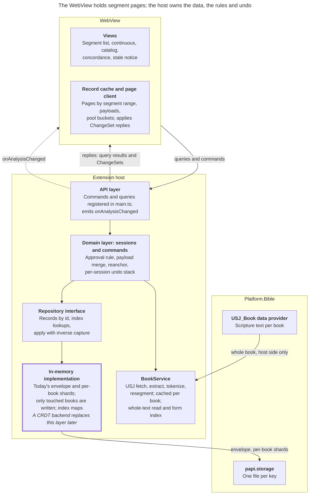
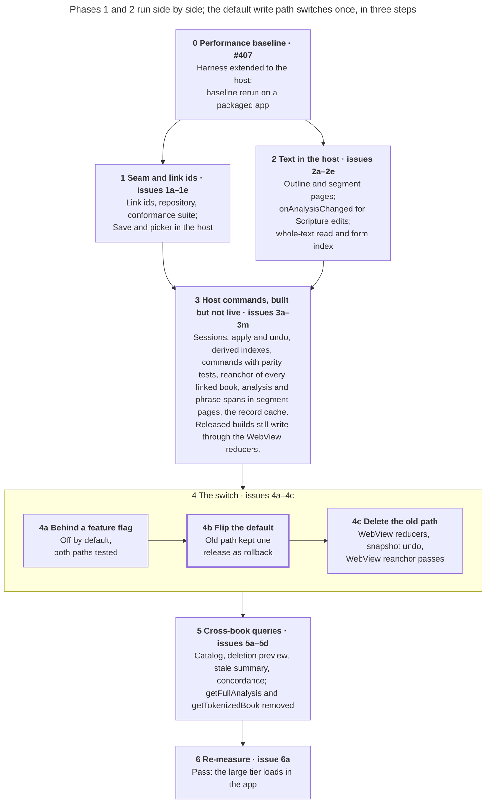

# Data layer plan (#403)

The extension host takes ownership of the analysis, the domain logic and undo, and serves the WebView segment pages: the text and analysis for a segment range. Every release along the way has exactly one default write path.

Storage stays in today's format behind one repository interface, which a CRDT backend can replace later. That interface and its conformance suite, the tests any backend must pass, are the seam.

Merged from three earlier plans, D, A and J, using the decisions the team made on 2026-10-09. "Today" means main at 1d788a24 (2026-10-15), after #399 began checking analyses against the whole source text.

## Decisions

The team decided these on 2026-10-09. "From" names the plan each choice came from. Rows marked _carried_ were not discussed directly; they follow from decisions above them and are open to correction.

| Question                                               | Decision                                                                                                                                                                                                                                                                                                                       | From    |
| ------------------------------------------------------ | ------------------------------------------------------------------------------------------------------------------------------------------------------------------------------------------------------------------------------------------------------------------------------------------------------------------------------ | ------- |
| Who owns the data                                      | The host owns the analysis, the domain logic and undo. The WebView is a cache of the segment pages on screen                                                                                                                                                                                                                   | D, A, J |
| Domain logic                                           | Host commands written against the repository replace the reducers. No release has a broken intermediate state: exactly one write path is live at a time; the feature flag picks which                                                                                                                                          | J       |
| Approval rule (one approved link per token or segment) | Enforced in the domain layer. Loads and PT9 import saves keep reporting breaches at the storage boundary; the breach report on project Save is removed in 4c                                                                                                                                                                   | J       |
| Storage layout                                         | Today's format: the envelope (the project record) plus per-book shards (one stored analysis per book). Only books an edit touched since the last autosave are rewritten; a write touches every book that links a payload it changes, found through the analysis-id index                                                       | J       |
| Existing data                                          | No model version bump and no migration. Existing data is disposable; a draft or saved interlinear project with any link that has no id loads as empty, with a log entry                                                                                                                                                        | —       |
| Storage-model changes for the CRDT direction           | Ids on every link; derived indexes (lookups by token ref, segment id, analysis id, normalized form, and book plus status) rebuilt from the records and never trusted; a conformance suite at the seam                                                                                                                          | D, A, J |
| CRDT                                                   | Not chosen. No spike in this plan, and the seam doesn't name a backend                                                                                                                                                                                                                                                         | D, A    |
| Draft vs. saved interlinear project                    | The split stays. Save and Save As copy inside the host. Draft-as-pending-changes is left to the CRDT design                                                                                                                                                                                                                    | D, A, J |
| Paging unit                                            | Segment ranges, plus a book outline                                                                                                                                                                                                                                                                                            | D, J    |
| Change delivery                                        | Commands reply to the caller with the `ChangeSet`, a list of whole-record puts and deletes, and beside it the pool buckets it touched. `onAnalysisChanged` names the touched segment ranges, analysis ids and cross-book queries so other views refetch; a Scripture edit or a future Send/Receive names a whole book or scope | A       |
| Undo                                                   | Inverse `ChangeSet`s captured in the repository's `apply`; one linear stack per session; undo and redo re-anchor what they restore to the current text, as on main; a whole-scope change (New, Open or opening a session, but not a wipe) clears the history, and 3j sets how large a Scripture edit must be to clear it too   | D, A, J |
| Transport                                              | PAPI commands plus one network event, not a data provider                                                                                                                                                                                                                                                                      | D, A, J |
| Optimistic updates                                     | None, unless the edit-latency check at 4a fails: with the feature flag on, the host path's dispatch-to-render p90 exceeds the #407 performance baseline's p90 at any tier. A failure adds an issue for the layer, and the flip waits for it                                                                                    | D, A, J |
| Shared payloads                                        | One record in the repository, in pages and in replies, never copied per book. Each book's shard keeps its own copy, as today                                                                                                                                                                                                   | D, A, J |
| Addressing                                             | _Carried:_ each open draft gets a session, a host-side handle for the draft and its interlinear project, addressed by a `sessionId`                                                                                                                                                                                            | J       |
| Concurrent commands                                    | _Carried:_ no segment-page versions; the host queues commands and reanchor passes per session and runs one at a time, since async commands would otherwise interleave, and only one WebView opens per source project                                                                                                           | —       |
| Suggestions                                            | _Carried:_ pool buckets, the approved payloads that share a normalized form, ride in segment pages and in replies; the WebView keeps `deriveTokenSuggestion`                                                                                                                                                                   | J       |
| Whole-text read                                        | _Carried:_ the host reads every book of the source text at session open, re-anchors each linked book as it arrives and builds a form-in-text index, so Stale covers the whole draft once the read finishes. The checkpoint after 2e decides whether that cost is affordable; if not, the read stays on demand, as on main      | —       |

## The seam

After Phase 5, only queries, commands, their replies and one network event cross PAPI. A CRDT backend later replaces the in-memory implementation; the domain layer, the API layer and the WebView stay put.

### API sketch

The names are working names, settled when each issue lands. Every call is a PAPI command. In this plan a _command_ changes state (an edit, undo, Save, or opening a session) and a _query_ only reads; the Kind column says which. A command by intent is one command, such as `writeGloss`; a command family is the set of commands one issue builds. The _boundary delta_ is the draft's `SegmentationDelta`: its custom segment boundaries, stored as a delta from one segment per verse.

| Call                                                                              | Kind    | Request                                                                                                | Response                                                                                                                                                                                                   | Replaces today                                          | Issue      |
| --------------------------------------------------------------------------------- | ------- | ------------------------------------------------------------------------------------------------------ | ---------------------------------------------------------------------------------------------------------------------------------------------------------------------------------------------------------- | ------------------------------------------------------- | ---------- |
| `openSession` / `closeSession`                                                    | command | source project, optional interlinear project                                                           | `sessionId`, read-only flag, `hasFreeTranslations`                                                                                                                                                         | `getDraft` seeding Redux                                | 3a         |
| `getBookOutline`                                                                  | query   | source project plus the WebView's boundary delta (2b to 4c), or session (from 3k); book                | Segment ids, verse labels, each segment's `heading` (from `Segment`), token counts, stale flags; from 3k, each segment's count of orphaned free-translation cards                                          | `useBookIndexes`, `useSegmentHeights`, the chapter list | 2b, 3k, 5c |
| `getSegments`                                                                     | query   | source project plus the WebView's boundary delta (2b to 4c), or session (from 3k); book, segment range | Tokenized segments; from 3k, their links, referenced payloads and pool buckets, and the orphaned free translations placed in the range; from 3l, each phrase touching the range with all its member tokens | `USJ_Book` fetch and tokenizing in the WebView          | 2b, 3k, 3l |
| Commands by intent (`writeGloss`, `approveAnalysisForToken`, `createPhrase`, ...) | command | session, intent arguments                                                                              | `ChangeSet`, plus touched pool buckets                                                                                                                                                                     | Dispatch plus whole-draft `saveDraft`                   | 3d to 3i   |
| `undo` / `redo`                                                                   | command | session                                                                                                | `ChangeSet`, plus touched pool buckets                                                                                                                                                                     | Whole-draft snapshots in `undo-history.ts`              | 3b         |
| `save` / `saveAs`                                                                 | command | draft (1d); session (from 4a), metadata                                                                | Project metadata                                                                                                                                                                                           | `saveAnalysis` with the whole analysis                  | 1d, 4a     |
| `getTextReadStatus`                                                               | query   | source project (2e to 4c), or session (from 3k)                                                        | Books read, books in the text, books that failed to read                                                                                                                                                   | The read status `TextReadingStatus` shows               | 2e, 3k     |
| `getCatalogRows`                                                                  | query   | session, filter, sort, offset, count                                                                   | Rows plus a total                                                                                                                                                                                          | `selectCatalogRows`                                     | 5a         |
| `countUsages`                                                                     | query   | session, analysis ids                                                                                  | How many distinct tokens approve any of them                                                                                                                                                               | `distinctUsageCount`                                    | 5a         |
| `previewDeletion`                                                                 | query   | session, analysis id                                                                                   | Deletion outcome                                                                                                                                                                                           | `selectAnalysisDeletionOutcome`                         | 5b         |
| `previewRemovals`                                                                 | query   | session, a command by intent with its arguments                                                        | Ids of the records the command would remove                                                                                                                                                                | `useGlossClearReclaims`, `useStaleLocationReclaims`     | 3i         |
| `getStaleSummary`                                                                 | query   | session, book                                                                                          | Stale links and free translations                                                                                                                                                                          | The stale selectors                                     | 5c         |
| `getConcordance`                                                                  | query   | session, form, offset, count                                                                           | Rows joined with their payloads                                                                                                                                                                            | `useConcordanceEntries` and the panel joins             | 5d         |
| `onAnalysisChanged`                                                               | event   | —                                                                                                      | Source project (2d to 4c) or session (from 3k), change id, touched segment ranges by book, analysis ids, affected cross-book queries; a whole book or scope for Scripture edits                            | Nothing today                                           | 2d, 3k     |
| `getTokenizedBook`, `getFullAnalysis`                                             | query   | source project, book (`getTokenizedBook`); session (`getFullAnalysis`)                                 | Whole book, whole analysis                                                                                                                                                                                 | Temporary bridges, both removed in 5d                   | 2a, 4a     |

### Contract rules

These rules describe the target state after Phase 5.

- A `ChangeSet` is a list of whole-record puts and deletes, keyed by record type and id. It and its inverse also carry boundary changes, so replies and undo cover boundary edits as they do today; 3b settles how.
- The repository's `apply` is all-or-nothing, records each record's prior value for undo, and keeps the derived indexes current.
- Derived indexes are rebuilt from the records on load and never trusted over them.
- Every repository call is async, index lookups included, and lookups take keys in batches.
- Index lookups are part of the repository interface, and the conformance suite tests them. The in-memory implementation backs them with maps; a later backend answers them its own way.
- Index lookups promise no order. Where a command must pick one record, the domain layer picks by a rule (1a).
- The domain layer enforces the approval rule before it calls `apply`.
- A command reply is its `ChangeSet` plus, beside it, the pool buckets it touched; a wipe's reply also carries `hasFreeTranslations`.
- No read returns a whole document.
- The conformance suite defines the seam. Any later backend passes it to replace the in-memory implementation.

## Phases at a glance

| #   | Phase                             | What the WebView sees               | Why each release is whole                                                                   | Needs |
| --- | --------------------------------- | ----------------------------------- | ------------------------------------------------------------------------------------------- | ----- |
| 0   | Performance baseline              | Nothing                             | Measurement only                                                                            | —     |
| 1   | Seam and link ids                 | Faster Save and picker              | The repository sits behind today's `getDraft`/`saveDraft`; the WebView still owns the edits | 0     |
| 2   | Text in the host                  | Text from outline and segment pages | Only text moves; analysis is untouched                                                      | 0     |
| 3   | Host commands, built but not live | Nothing                             | No released build calls the new write path                                                  | 1, 2  |
| 4   | The switch                        | Edits, undo and Save go to the host | A feature flag, then a flip with a rollback, then deletion                                  | 3     |
| 5   | Cross-book queries                | Panels call host queries            | One query per PR; `getFullAnalysis` and `getTokenizedBook` cover the rest                   | 4     |
| 6   | Re-measure                        | Nothing                             | Measurement only                                                                            | 5     |

Phases 1 and 2 don't depend on each other and can proceed in parallel. The switch is all of Phase 4. The flip (4b) is its middle step: the one release where the feature flag's default, and with it the default write path, changes.

## Phases

### Phase 0: Performance baseline

Phase 0 is [#407](https://github.com/sillsdev/interlinearizer-extension/issues/407), which defines the dataset tiers, the `ilz:` marks and the timing names used below. It covers the baseline harness (PR #411), extends it to the host because later phases move memory and time out of the WebView, and reruns the baseline on a packaged app, reported as median and p90. All of it is done before Phases 1 and 2 start.

- Host process heap through a debug PAPI command, and host-side `ilz:` marks.

**Done when:** a run reports host and WebView numbers side by side.

### Phase 1: Seam and link ids

Every read and write of interlinear data goes through the repository, and links get ids. The WebView doesn't change, apart from Save and the picker getting faster.

- **Link ids.** `TokenAnalysisLink` and `SegmentAnalysisLink` gain an `id`, and the reducers and the PT9 converter (`mergeLanguageAnalyses`) write one on every new link. A draft or saved interlinear project with any link that has no id loads as empty, with a log entry. There's no version bump and no migration.
- **Picks by rule.** Where the reducers pick one record by list order, they pick by rule instead, so 3d to 3i port rules rather than order. The latest `updatedAt`, then the smallest id, wins an approval tie, for words and segments alike. A merge folds the edited payload into the identical one with the earliest `createdAt`, then the smallest id.
- **Repository.** An async interface plus an in-memory implementation over today's envelope and per-book shards. `getDraft` and `saveDraft` keep their contracts but route through it, and an autosave still rewrites only the shards whose JSON changed, as on main. It keeps `projectStorage`'s guards, such as refusing to overwrite a record written by a newer build. It also runs in Node with file-backed storage, so the #407 harness can seed its tiers without PAPI once 1d and 4c break seeding over PAPI.
- **Conformance suite.** It runs against the in-memory implementation, stays for good, and is the bar any later backend must pass.
- **Save in the host.** The pending autosave is the WebView's debounce timer, so before Save or Save As the WebView sends its pending `saveDraft` and waits for it. The host then copies the draft into the interlinear project. The WebView sends only metadata.
- **Project summaries.** The existing `InterlinearProjectSummary`, stored on every project write instead of built per request, so the picker and `getPt9ImportForSource` read summaries for the requested source only.

**Surface:** no new WebView calls; Save takes metadata only.

**Done when:** Save and the picker send no analysis.

### Phase 2: Text in the host

The host fetches and tokenizes the text, and the WebView renders from an outline and segment pages. It can run alongside Phase 1.

- A `BookService` subscribes to `USJ_Book` for open books, runs extraction and tokenizing, and caches the tokenized book. It resegments per request from the boundary delta it's given, re-anchoring splits as `reanchorSegmentation` does today.
- `getBookOutline` and `getSegments` (text only) feed the segment list, height prediction, the chapter list and the continuous view. Host marks record page-fetch latency.
- A temporary `getTokenizedBook` gives the WebView whole tokenized books: for its reanchor passes and `useBookIndexes` until 4c, and for its whole-text read (the concordance and the catalog's "Word not in the text" and draft-wide Stale filters) until 5d. From 4a, segment pages and their phrase spans (3l) feed the token-level maps. The WebView stops fetching USJ.
- `onAnalysisChanged` arrives here with its first producer: a Scripture edit names the whole book, and the WebView refetches.
- A whole-text read in `BookService` reads every book, keeps a form-in-text index (the normalized forms the text holds), and reports progress and failed books through `getTextReadStatus`. Nothing calls it until 4a; then `openSession` starts it, 3j re-anchors each linked book as it arrives, and 5a and 5d answer from it.
- These queries and the event are addressed by source project, since text needs no draft. They also accept a session from 3k, when analysis joins the segment pages; the source-project form is removed in 4c. Until then boundary edits stay in the WebView draft, so the source-project form also takes the WebView's boundary delta: a boundary edit changes the request and the WebView refetches, and the import view sends none.

**Done when:** the WebView neither fetches nor tokenizes USJ, and no view walks the whole book except through `getTokenizedBook`.

### Phase 3: Host commands, built but not live

The whole write path is built and tested in the host while the WebView keeps using its reducers. Nothing in this phase is called by a released WebView, so every release still has one write path.

- **Sessions** over a draft and its interlinear project, plus `setAnalysisLanguage`; `openSession` returns `hasFreeTranslations`. A PT9 import's session is read-only.
- **The repository's `apply` with inverse capture,** and a linear per-session undo stack on top of it.
- **Derived indexes.** By token ref, segment id, analysis id, normalized form, and book plus status. They're rebuilt from the records on load and kept current by `apply`, and a debug PAPI command rebuilds them and reports differences.
- **Commands by family:** tokens (gloss, approve, plus payload dedupe and merge, with the approval rule enforced here), morphemes, phrases, segment free translations and boundaries, stale handling, catalog-wide edits, and wipes. Commands copy what the app does today and add nothing.
  - **Parity tests.** Each family has them: they run one input through today's reducer and the new command and compare the results.
  - **Boundaries and wipes.** These aren't reducers, so their parity tests run against `wipeBook`, `wipeAll` and the WebView's boundary dispatch, which breaks every phrase a new boundary would cut. The host's split and move break those phrases in the same `ChangeSet`, so the WebView needs no book-wide token order for it.
  - **Removal previews.** A bulk gloss clear and a stale discard or reapply first ask about any unsaved breakdown on a record they would remove. Today that check runs the reducer, which 4c deletes, so 3i also builds `previewRemovals`.
- **The reanchor pass** over every book the draft links into, as 2e's read delivers each one, through the session's queue. A pass isn't an undo step: an undo or redo re-anchors what it restores to the current text, as `recordBookPass` does today. Links into a book the text lacks go stale, as `reanchorDraftToMissingBook` does today.
- **Orphaned free translations,** those of verses the book no longer has. 3h's discard covers them, and 3k places them as main does.
- **Analysis in segment pages:** `getSegments` gains links, referenced payloads, pool buckets and the orphaned free translations placed in the range, and `onAnalysisChanged` gains touched segment ranges, analysis ids and affected cross-book queries. `getBookOutline`, `getSegments`, `getTextReadStatus` and `onAnalysisChanged` also accept a session; the analysis fields come back only to the session form, and the source-project form stays text-only.
- **Phrase spans in segment pages:** the session form of `getSegments` also returns each phrase that touches the range with all its member tokens, even those outside the range, and the WebView builds its token-level maps from pages plus spans, since a phrase can span segments that aren't loaded.
- **The WebView's record cache and page client,** built and tested but not wired up, including how a refetch that lands after a newer reply is kept from overwriting it.

**Done when:** every reducer, boundary move and wipe has a command that passes its parity tests, and the cache passes its own tests.

### Phase 4: The switch

The WebView moves to the host write path in three releasable steps, with a rollback in the middle.

1. **Wire it behind a feature flag, off by default.** The WebView can run on sessions, commands, queries and the cache. A temporary `getFullAnalysis`, removed in 5d, feeds the catalog, the concordance and the deletion preview. With the flag on, the host re-anchors every linked book during the session-open read, and the WebView's whole-text read, which still feeds the concordance and the catalog's text filters, no longer re-anchors. The Stale filter learns from `getTextReadStatus` when it covers the whole draft. End-to-end tests run on both paths. 4a decides where the flag lives, such as a localStorage key or a hidden setting; developers and end-to-end tests must both be able to set it.
2. **Flip the default,** once 4a's edit-latency check passes. The old path stays one release as the rollback; rolling back means a release that flips the default again.
3. **Delete the old path:** the WebView reducers, the parity tests, whole-draft `getDraft`/`saveDraft`, snapshot undo, the WebView reanchor passes (the loaded book's and the whole-text read's), the Stale filter's "(found when a book is opened)" qualifier, the source-project form of `getBookOutline`, `getSegments`, `getTextReadStatus` and `onAnalysisChanged`, and the breach report on project Save.

**Done when:** no edit, undo or Save sends a whole draft or analysis, and the WebView holds only the segment pages it shows plus what `getFullAnalysis` and `getTokenizedBook` still feed.

### Phase 5: Cross-book queries

Phase 4 removes the old write path; Phase 5 removes the two read bridges, `getFullAnalysis` and `getTokenizedBook`. Each cross-book answer becomes a host query, one PR each. The last, 5d, removes both bridges along with the WebView's whole-text read.

- `getCatalogRows`, paged by offset, and `countUsages`; `previewDeletion`; `getStaleSummary` plus stale flags in the outline; and `getConcordance`, paged by offset. The text scans, the concordance's occurrences and 2e's form-in-text index, live in `BookService`, outside the repository seam. The session joins them with the repository's links and payloads for `getConcordance` and for `getCatalogRows`' "Word not in the text".
- `getCatalogRows` answers "Word not in the text" from 2e's index, and the catalog shows read progress and failure from `getTextReadStatus`.

**Done when:** no WebView code reads the whole analysis or the whole text.

### Phase 6: Re-measure

Rerun the #407 performance baseline.

**Done when:** the large tier loads in the app. Today it can't, because its draft is 133 MB on the wire, over core's 100 MiB WebSocket message cap (`MAX_WEBSOCKET_PAYLOAD_BYTES`).

## Issue breakdown

The plan splits into 31 new issues plus #407, each one or two PRs that leave the app working. Every issue merges to main; Phase 3's unwired code and 4a's feature flag keep main releasable, so there's no long-lived branch. Ids are local to this plan until they're filed as sub-issues of #403; from then on the sub-issues are the source of truth, and this table isn't kept in sync. 1a and 2a start once #407 is done, and Phases 1 and 2 run side by side.

| Id       | Issue and done when                                                                                                                                                                                                                                                                                                                                                                                                                                                                                                                                                                                                                                                                                                                                                                                                 | Depends on     |
| -------- | ------------------------------------------------------------------------------------------------------------------------------------------------------------------------------------------------------------------------------------------------------------------------------------------------------------------------------------------------------------------------------------------------------------------------------------------------------------------------------------------------------------------------------------------------------------------------------------------------------------------------------------------------------------------------------------------------------------------------------------------------------------------------------------------------------------------- | -------------- |
| **#407** | Performance baseline harness (PR #411), host metrics, and a baseline run. _Done when_ #407's own done-when list is met                                                                                                                                                                                                                                                                                                                                                                                                                                                                                                                                                                                                                                                                                              |                |
| **1a**   | Ids on token and segment links; the reducers and the PT9 converter write them; a draft or saved interlinear project with any link that has no id loads as empty, with a log entry; the reducers pick approval ties and merge survivors by rule, not list order. _Done when_ every new link has an id, approval ties and merges pick the same record whatever the list order, a new PT9 import and its editable copy keep their analyses through save and reload, and old data loads empty without error                                                                                                                                                                                                                                                                                                             | #407           |
| **1b**   | Async repository interface and in-memory implementation over today's format; `getDraft`/`saveDraft` route through it; a Node seeding path through it replaces the #407 harness's PAPI seeding. _Done when_ the existing unit and e2e suites pass unchanged, a newer build's draft survives an attempted write, and the #407 harness seeds every tier without PAPI                                                                                                                                                                                                                                                                                                                                                                                                                                                   | 1a             |
| **1c**   | Conformance suite for the repository, kept permanently. _Done when_ it runs in CI against the in-memory implementation                                                                                                                                                                                                                                                                                                                                                                                                                                                                                                                                                                                                                                                                                              | 1b             |
| **1d**   | Save and Save As in the host: the WebView sends its pending autosave and waits for it, then the host copies. _Done when_ Save sends no analysis                                                                                                                                                                                                                                                                                                                                                                                                                                                                                                                                                                                                                                                                     | 1b             |
| **1e**   | `InterlinearProjectSummary` written on every project write, with lookups by source; the picker and `getPt9ImportForSource` read summaries. _Done when_ the picker response size doesn't depend on analysis size                                                                                                                                                                                                                                                                                                                                                                                                                                                                                                                                                                                                     | 1b             |
| **2a**   | `BookService` in the host with a temporary `getTokenizedBook`, removed in 5d; it tokenizes only once the project's language tag has loaded, and caches per book and tag (#421); the WebView stops fetching and tokenizing USJ. _Done when_ tokens match the WebView tokenizer's output on the #407 datasets, and opening a book tokenizes it once                                                                                                                                                                                                                                                                                                                                                                                                                                                                   | #407           |
| **2b**   | `getBookOutline` and `getSegments` (text), addressed by source project and taking the WebView's boundary delta, with page-fetch latency marks; the segment list, height prediction and chapter list read them. _Done when_ the segment list view loads by outline and segment pages, and they match main's rendered book, orphaned free-translation cards included, which the WebView still places from its draft until 3k, with custom boundaries, after a boundary edit and after a Scripture edit                                                                                                                                                                                                                                                                                                                | 2a             |
| **2c**   | Continuous view over segment pages. _Done when_ it flattens only the `useSegmentWindow` range                                                                                                                                                                                                                                                                                                                                                                                                                                                                                                                                                                                                                                                                                                                       | 2b             |
| **2d**   | `onAnalysisChanged`, addressed by source project, with its first producer: a Scripture edit names the book, and the WebView refetches. _Done when_ editing Scripture refreshes the open view                                                                                                                                                                                                                                                                                                                                                                                                                                                                                                                                                                                                                        | 2b             |
| **2e**   | Whole-text read in `BookService`: reads every book of the source text, keeps a form-in-text index, and reports progress and failed books through `getTextReadStatus`; addressed by source project, and from 3k by session. Not called by the WebView yet. _Done when_ on the #407 datasets the index finds the same catalog forms not in the text as main's whole-text read, a book that fails to read is reported and turns off "not in the text" marking, and a Scripture edit updates that book's entries                                                                                                                                                                                                                                                                                                        | 2a, 2d         |
| **3a**   | Sessions over a draft and its interlinear project, plus `setAnalysisLanguage`; read-only for PT9 imports. Not called by the WebView yet. _Done when_ sessions open on a draft, a draft with its interlinear project, and a PT9 import, and commands on an import's session are refused, and `openSession` returns `hasFreeTranslations` as main computes it, and `setAnalysisLanguage` passes its parity test                                                                                                                                                                                                                                                                                                                                                                                                       | Phases 1, 2    |
| **3b**   | The repository's `apply` with inverse capture and a linear per-session undo stack; settles how a `ChangeSet` carries boundary changes. _Done when_ conformance tests cover undo and redo, boundary changes included, and a payload linked from two books, edited through one, saves and reloads with the edit                                                                                                                                                                                                                                                                                                                                                                                                                                                                                                       | 1c, 3a         |
| **3c**   | Derived indexes rebuilt from records on load and kept current by `apply`, plus a debug rebuild-and-diff PAPI command. _Done when_ the debug PAPI command reports no differences on the #407 datasets                                                                                                                                                                                                                                                                                                                                                                                                                                                                                                                                                                                                                | 3b             |
| **3d**   | Token commands (gloss, approve, payload dedupe and merge) with the approval rule, plus parity tests. Sets the pattern for 3e to 3i. _Done when_ its commands pass their parity tests                                                                                                                                                                                                                                                                                                                                                                                                                                                                                                                                                                                                                                | 3b, 3c         |
| **3e**   | Morpheme commands, with parity tests. _Done when_ its commands pass their parity tests                                                                                                                                                                                                                                                                                                                                                                                                                                                                                                                                                                                                                                                                                                                              | 3d             |
| **3f**   | Phrase commands, with parity tests. _Done when_ its commands pass their parity tests                                                                                                                                                                                                                                                                                                                                                                                                                                                                                                                                                                                                                                                                                                                                | 3d             |
| **3g**   | Segment free-translation and boundary commands, with parity tests; a split or move breaks every phrase the new boundary would cut, in the same `ChangeSet`. _Done when_ its commands pass their parity tests                                                                                                                                                                                                                                                                                                                                                                                                                                                                                                                                                                                                        | 3d, 3f         |
| **3h**   | Stale-handling commands, with parity tests; discard covers orphaned free translations. _Done when_ its commands pass their parity tests                                                                                                                                                                                                                                                                                                                                                                                                                                                                                                                                                                                                                                                                             | 3d             |
| **3i**   | Catalog-wide edits and wipes, with parity tests; a wipe's reply carries `hasFreeTranslations` beside the `ChangeSet`; `previewRemovals`. _Done when_ its commands pass their parity tests, a wipe's reply gives `hasFreeTranslations` as main computes it, and `previewRemovals` names the records `useGlossClearReclaims` and `useStaleLocationReclaims` do                                                                                                                                                                                                                                                                                                                                                                                                                                                        | 3d, 3h         |
| **3j**   | Reanchor pass in the host over every book the draft links into, as 2e's read delivers each one, through the session's queue; not an undo step, since an undo or redo re-anchors what it restores to the current text, as main does; re-evaluates whether an undo reply that isn't a pure inverse is acceptable; links into a book the text lacks go stale, as `reanchorDraftToMissingBook` does; sets how large a Scripture edit must be to clear the undo history. _Done when_ its result matches the WebView passes on the #407 datasets, which hold no drift, on the drift cases in `reanchor-analysis.test.ts` and on the missing-book cases in `reanchor-draft.test.ts`, and undo and redo restore content re-anchored to the current text                                                                     | 2e, 3b         |
| **3k**   | Analysis in segment pages: `getSegments` gains links, payloads, pool buckets and the orphaned free translations placed in the range, the outline gains each segment's orphaned-card count, and command replies carry the touched pool buckets beside the `ChangeSet`; `onAnalysisChanged` gains segment ranges, analysis ids and affected cross-book queries; `getBookOutline`, `getSegments`, `getTextReadStatus` and `onAnalysisChanged` also accept a session, and only the session form returns the analysis fields. _Done when_ on the #407 datasets, `getSegments` returns the same links, payloads and pool buckets the WebView store holds for each range, orphaned free translations land where the WebView places them, and each command's `onAnalysisChanged` names exactly what its `ChangeSet` touched | 2e, 3d to 3i   |
| **3l**   | Phrase spans in segment pages: the session form of `getSegments` also returns each phrase that touches the range with all its member tokens, and the WebView builds its token-level maps and boundary-slot guard from pages plus spans; a focus request from the catalog, the concordance or undo still lands when its target's page hasn't loaded. _Done when_ on the #407 datasets, phrase text, arcs and focus for phrases that span unloaded segments match what today's book-wide maps give, and a jump into a segment that hasn't loaded focuses its target                                                                                                                                                                                                                                                   | 3k             |
| **3m**   | WebView record cache and page client, built and tested but not wired up; settles how a refetch that lands after a newer reply is kept from overwriting it. _Done when_ applying a command's reply to the cache gives the same segment pages and pool buckets as refetching them, after a boundary command the outline matches a refetch too, and a refetch that lands after a newer reply leaves the reply's records in place, in tests over the #407 datasets                                                                                                                                                                                                                                                                                                                                                      | 2b, 3l         |
| **4a**   | Wire the WebView to sessions, commands, queries and the cache behind a feature flag, off by default; add a temporary `getFullAnalysis`, removed in 5d; with the flag on, the Stale filter learns from `getTextReadStatus` when it covers the whole draft. _Done when_ end-to-end tests pass with the flag on and off, and with the flag on, dispatch-to-render p90 doesn't exceed the #407 baseline's p90 at any tier, edits during the session-open read included                                                                                                                                                                                                                                                                                                                                                  | 3c to 3m       |
| **4b**   | Flip the default; keep the old path for one release. _Done when_ the release ships on the host path                                                                                                                                                                                                                                                                                                                                                                                                                                                                                                                                                                                                                                                                                                                 | 4a             |
| **4c**   | Delete the old path: WebView reducers, parity tests, whole-draft `getDraft`/`saveDraft`, snapshot undo, the WebView reanchor passes, the Stale filter's "(found when a book is opened)" qualifier, the source-project form of `getBookOutline`, `getSegments`, `getTextReadStatus` and `onAnalysisChanged`, and the breach report on project Save. _Done when_ nothing references the deleted code, and e2e tests pass                                                                                                                                                                                                                                                                                                                                                                                              | 4b             |
| **5a**   | `getCatalogRows`, paged by offset, and `countUsages`; "Word not in the text" from 2e's index; the catalog panel uses them, with read progress and failure from `getTextReadStatus`. _Done when_ the catalog panel shows the same rows, sorts, filters and read status as before, from `getCatalogRows` and `getTextReadStatus`, and the selection bar and bulk actions report the same use counts as `distinctUsageCount`                                                                                                                                                                                                                                                                                                                                                                                           | 2e, 4c         |
| **5b**   | `previewDeletion`; the delete confirmation uses it. _Done when_ the delete confirmation shows the same outcome as `selectAnalysisDeletionOutcome`, with no `uncertain` for unloaded books                                                                                                                                                                                                                                                                                                                                                                                                                                                                                                                                                                                                                           | 4c             |
| **5c**   | `getStaleSummary` and stale flags in the outline; the stale notice uses them; settles whether outline stale flags ride in command replies or are refetched on `onAnalysisChanged`. _Done when_ the stale notice shows the same counts as today's stale selectors, orphaned free translations included, from `getStaleSummary` and the outline's stale flags                                                                                                                                                                                                                                                                                                                                                                                                                                                         | 4c             |
| **5d**   | `getConcordance`, paged by offset: the session joins occurrences from 2e's read in `BookService` with links and payloads from the repository, and its request leaves room for #50's search, sort and coverage filters (coverage joins the analysis to the text); then remove `getFullAnalysis`, `getTokenizedBook` and the WebView's whole-text read. _Done when_ the concordance panel shows the same rows and read status as before, from `getConcordance` and `getTextReadStatus`, and no WebView code reads the whole analysis or the whole text                                                                                                                                                                                                                                                                | 2e, 5a, 5b, 5c |
| **6a**   | Rerun the #407 baseline. _Done when_ the large tier loads in the app                                                                                                                                                                                                                                                                                                                                                                                                                                                                                                                                                                                                                                                                                                                                                | #407, 5d       |

## Performance checkpoints

Rerun the #407 performance baseline, with its host metrics, after these points. Each one decides something or confirms a phase did its job. The baseline numbers below are provisional medians from the first #411 run; #407's rerun replaces them with median and p90.

| After        | What to check                                                                                                                                     | Baseline (large-loadable)                  |
| ------------ | ------------------------------------------------------------------------------------------------------------------------------------------------- | ------------------------------------------ |
| Phase 1      | Bytes per Save and per picker response                                                                                                            | Save 74.7 MB; picker 83.8 MB               |
| Phase 2      | Book load, now split between host and WebView                                                                                                     | Open to interactive 3,499 ms               |
| 2e           | Whole-text read time and host heap with every book read; decides whether the host reads every book at session open or, as on main, only on demand | The concordance read in #407               |
| 4a (flag on) | Edit latency over the round trip, during the session-open read too; decides whether an optimistic layer is needed                                 | Dispatch to render 444 ms                  |
| 4c           | WebView heap with a full undo history, and host heap                                                                                              | WebView 1,877 MB                           |
| 6a           | Everything, against the original baseline. Pass/fail: the large tier loads                                                                        | Large tier can't load (133 MB on the wire) |

## Cross-book answers

Each answer that spans books, where it comes from after Phase 5, and how fresh it is. Only the pool and, after a wipe, `hasFreeTranslations` travel in command replies, beside the `ChangeSet`. `openSession` also returns `hasFreeTranslations`, and project summaries are stored. The rest are queries that views refetch when `onAnalysisChanged` names them.

| Answer                 | Today                                                                                                   | Planned                                                                                                                     | Freshness                                         | Issue  |
| ---------------------- | ------------------------------------------------------------------------------------------------------- | --------------------------------------------------------------------------------------------------------------------------- | ------------------------------------------------- | ------ |
| Suggestion pool        | `selectPoolIndex`, rebuilt from every approved payload on each change                                   | Pool buckets by normalized form, from the derived indexes, in segment pages and replies                                     | Live                                              | 3k     |
| Catalog rows and usage | `buildCatalogRows` over every link                                                                      | `getCatalogRows`, paged by offset in the host                                                                               | Refetched when named                              | 5a     |
| Use counts             | `distinctUsageCount` over the catalog rows                                                              | `countUsages` in the host                                                                                                   | On demand                                         | 5a     |
| Deletion outcome       | Scans every link; `uncertain` for unloaded books                                                        | `previewDeletion` in the host, which sees every book's links                                                                | On demand                                         | 5b     |
| Records a write drops  | Runs the reducer on a copy of the store                                                                 | `previewRemovals` in the host                                                                                               | On demand                                         | 3i     |
| Stale summary          | Project-wide selectors filtered to the book                                                             | `getStaleSummary` plus stale flags in the outline                                                                           | Live for the open book                            | 5c     |
| `hasFreeTranslations`  | Scans every segment analysis                                                                            | Returned by `openSession`, and beside the `ChangeSet` in a wipe's reply; recomputed on New, Open and both wipes, as on main | At session open and after a wipe                  | 3a, 3i |
| Concordance            | The WebView reads and tokenizes every book                                                              | `getConcordance`, paged by offset: occurrences from 2e's read in `BookService`, joined with payloads in the session         | On demand                                         | 5d     |
| Forms in the text      | The concordance's whole-text read in the WebView, run when a catalog filter or the concordance needs it | 2e's form-in-text index, read at session open; `getCatalogRows` filters by it                                               | At session open, and per book on a Scripture edit | 2e, 5a |
| Text read status       | `TextReadingStatus` over the WebView's read                                                             | `getTextReadStatus`                                                                                                         | Refetched when named                              | 2e, 5a |
| Project summaries      | Reads every project in full                                                                             | Stored on every project write                                                                                               | Stored                                            | 1e     |

## Risks

| Risk                                                                    | Effect                                                                        | Mitigation                                                                                                                                                                                                                   |
| ----------------------------------------------------------------------- | ----------------------------------------------------------------------------- | ---------------------------------------------------------------------------------------------------------------------------------------------------------------------------------------------------------------------------- |
| Rewriting every reducer, boundary move and wipe changes subtle behavior | Wrong dedupe, repointing, import or stale handling                            | Parity tests per command family (3d to 3i); the old path stays one release after the flip (4b)                                                                                                                               |
| Unwired code drifts from the live reducers during Phase 3               | The switch exposes mismatches                                                 | Parity tests run on every PR until 4c; a reducer change in that window updates its command in the same PR                                                                                                                    |
| A round trip on every committed edit feels slow                         | Gloss entry lags                                                              | Gloss inputs already commit on blur or Enter; check at 4a with the flag on, and add an optimistic layer before the flip only if that fails                                                                                   |
| Whole-record inverses overwrite later changes                           | Undo restores a stale field, such as an old `tokenRef`                        | Every write goes through `apply`, reanchor included; a whole-scope change clears the history                                                                                                                                 |
| Undo after a Scripture edit restores old refs                           | Undo lands on drifted text                                                    | An undo or redo re-anchors what it restores to the current text, as on main; an edit past 3j's size line clears the history instead                                                                                          |
| Save copies an unflushed draft before 4b                                | Lost edits in the saved interlinear project                                   | In 1d the WebView sends its pending autosave and waits for it before calling `save`                                                                                                                                          |
| Bus size until 5d                                                       | Opening a draft still sends the whole analysis, and the large tier can't load | Expected until 5d removes `getFullAnalysis`; 6a checks it                                                                                                                                                                    |
| Reading every book at session open costs too much                       | Slow session open, or a large host heap                                       | The read runs in the background and the catalog shows its progress; the checkpoint after 2e decides, and the fallback is reading on demand, as on main, with the host re-anchoring each book as `getTokenizedBook` serves it |
| Clearing data without link ids surprises a tester                       | Lost drafts and saved interlinear projects                                    | Log it, and say in the release notes for the build that ships 1a: "A draft or saved interlinear project with any link that has no id loads as empty."                                                                        |

## Considered and rejected

- **A new storage layout** (D's change log, A's chapter chunks and payload buckets). The CRDT direction doesn't need one, and per-book dirty writes cover write cost until a real backend arrives.
- **Running the existing reducers in the host** (D, A). It would need a second rewrite when a database backend arrives, and `ChangeSet`s would have to be derived by diffing.
- **An approval register per token or segment** (A). The rule stays in the domain layer.
- **Field-level change sets, caller-made ids and timestamps, boundaries and metadata as records, read-back-after-write** (D). Not needed for this plan.
- **Chapter-range paging** (A). Segment ranges match `useSegmentWindow` and the per-book storage.
- **Segment-page versions on writes** (A's `applyOps`). One WebView per source project and per-session serialization leave only the order of replies and refetches, which 3m settles.
- **A data provider with range selectors** (D, A, J). Core doesn't filter updates by selector.
- **Migrating existing data** (A, J). The data is disposable.
- **Moving the text-only answers into Phase 2** (the concordance's occurrences and the form-in-text check, joined with the WebView's analysis), so 4c would remove the text bridge. It adds WebView wiring to Phase 2 and splits the concordance across two issues. It's the fallback if the 2e checkpoint or 4a's latency gate fails because the text is read twice from 4a to 5d.
- **A CRDT spike** (A), **naming Harmony in the seam** (J), and **draft as pending changes** (D). Left to the CRDT work.
